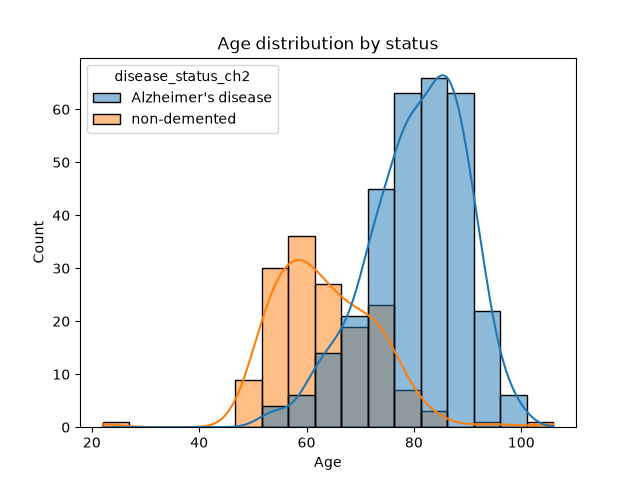
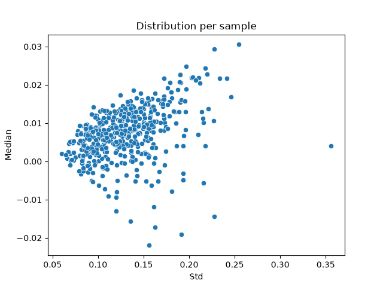
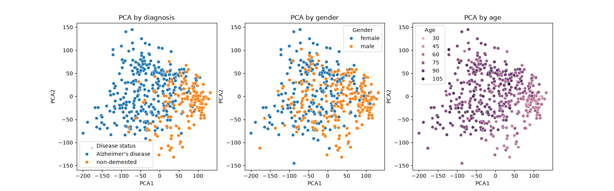
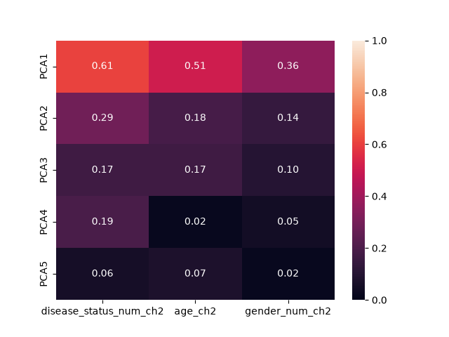

# Alzheimer's disease in the prefrontal cortex

## Question
How much of an Alzheimer's signal in the prefrontal cortex is disease, and how much is age, sex, or neuron loss?

## Seed
Random seed: 22

## Phase 1
- Created the folder and repository
- Created a new Python environment
- Installed all requirements
    - `ipykernel` and `six` were necessary to run
    - `six` was necessary to run `GEOparse`
- Seed defined
- `/data` removed from commit

### The data
[Series GSE33000](https://www.ncbi.nlm.nih.gov/geo/query/acc.cgi?acc=GSE33000)

The study focused on discovering which pairs of genes gained or lost correlation in Alzheimer's disease or Huntington's disease, using post-mortem prefrontal cortex tissues from 467 patients and 157 controls. The samples were obtained from the Harvard Brain Tissue Resource Center (HBTRC), and they used the GPL4372 Rosetta/Merck Human 44k 1.1 microarray.

The data chosen was the `GSE33000_series_matrix.txt` because the other `GSE33000_raw_data.txt` doesn't have the `GSM` nor the metadata, which wouldn't enable me to link the expression to the diagnosis.

### Separating data and metadata

I started by importing the pandas library and trying to read the data. Since both data and metadata are in the same file, I used the `comment` parameter to skip all lines from the metadata so I could have the data dataframe, instead of using `skiprows` and placing a fixed number.

For the metadata, I opened the file and read all lines, keeping only the lines starting with `!Sample_`. Since I only wanted the metadata, I ignored the `!Series_` lines because they are about the whole study, not each sample. The last row from the metadata had a `\n`, which I realized when I was comparing IDs, and it was returning `False`. So I cleaned that before creating the dataframe.

There were columns with the same name on the metadata dataframe. I set a name using a label present in each row to remove the duplicates, and added a `_ch1` (reference pool) or `_ch2` (person) based on the previous name to prevent new duplicated column names.

At the end, I verified there were:
- **Alzheimer's disease:** 310
- **non-demented:** 157
- **Huntington's disease:** 157

### Comparing IDs from both dataframes

All IDs are in both dataframes, which was verified by comparing both columns using `pd.Series.equals` and guaranteeing they're in the same order.

In the data dataframe, I got 39280 probes and kept the 624 samples, each as a column.

## Phase 2

### Cleaning `metadata.csv`

I loaded the new `metadata.csv` file and started by removing columns that had the same value for each row, and also the columns that had no value (`NaN`).

I converted the `age_ch2` column into integers to later analyze better the distribution.

For the `disease_status_ch2`, I **removed all patients with Huntington's disease**, since the focus is to analyze patients with Alzheimer's disease and compare with non-demented samples.

Also, I realized some columns had a different value for each row, which indicates an ID. So I kept only one of them, the one I used to compare with the `data.csv` file.

At the end, I had a table like this:
|age_ch2|gender_ch2|disease_status_ch2|geo_accession|
|-------|----------|------------------|-------------|

### Comparing age and gender by groups

Then, I created a table showing the number of samples, mean and standard deviation of age and percentage of women in each group. The results were:

|group              |n  |age (min)|age (max)|age(mean ± std) |female|
|-------------------|---|---------|---------|----------------|------|
|Alzheimer's disease|310|53       |100      |80.6 ± 9.0 years|56.5% |
|non-demented       |157|22       |106      |63.5 ± 9.9 years|21.7% |

To visualize better, I plotted a histogram to check the distribution of age from the two different groups.

### Using statistics tests to analyze the differences

Running a **Mann-Whitney test** for age and a **chi-square contingency test** for sex showed a very low p-value in both cases, showing a statistically significant difference between groups. I chose the Mann-Whitney because the distribution of age is not normal (as seen on the histogram) and because an extreme value could impact the p-value. This is related to the 17-year age difference and to having 35 more percentage points of women.

These differences can lead to a false conclusion because the results could actually be due to Alzheimer's disease patients being older than non-demented controls and having a higher proportion of women. 

Age and gender change gene expression in the brain, so a model could learn "female vs. male" or "older vs. younger" and appear to have learned "Alzheimer's vs. non-demented". We can see that XIST expression is about 100 times higher in females.

### Testing removing age range

I tested removing ages from 22 to 52 and 100+ years so both groups have the same range, since most data relies on the range 53-100, and we could have a fair comparison.

After running a second comparison, after removing the data range, I got:

|group              |n  |age (min)|age (max)|age(mean ± std) |female|
|-------------------|---|---------|---------|----------------|------|
|Alzheimer's disease|310|53       |100      |80.6 ± 9.0 years|56.5% |
|non-demented       |143|53       |95       |64.6 ± 8.3 years|23.1% |

Since the difference is not big, and the real problem is in the middle of the data, not on the edges, I decided not to remove samples based on the data at this point. The age difference went from 17 to 16, and removing the range only removed non-demented samples (14). Later on, this difference will be treated.

### Limitation

Post-mortem interval (PMI) was 17.8 ± 8.3 hours, sample pH was 6.4 ± 0.3, and RNA integrity number (RIN) was 6.8 ± 0.8 for the average sample in the overall cohort. Since these data are from the whole study, we cannot conclude anything about each sample. This is a limitation because it's not possible to test or control.

## Phase 3

Each value in the `data.csv` file represents the log10 ratio between a person and a reference. Values go from -2 to 2.

### Missing values

I opened both `metadata_ad_control.csv` and `data.csv` files so I could filter only samples with AD or non-demented. Then, I checked that there were 701 missing values. The maximum missing values per probe is 9, which represents 1.9% of all samples. The maximum missing values per sample is 80, representing 0.2% of all probes. Since these numbers are too small, they don't exceed the threshold, so for now, nothing is dropped.

### Distribution of median and standard deviation

I've created another dataframe with the median and standard deviation for each sample and plotted it using a scatter plot.

There was a specific point, a possible outlier, far from every point, so I decided to understand its group and gender.

|age_ch2|gender_ch2|disease_status_ch2 |geo_accession|
|-------|----------|-------------------|-------------|
|93     |female    |Alzheimer's disease|GSM1423944   |

After comparing the highest and second highest standard deviation, the outlier is much higher than the second one (0.36 versus 0.25). Also, it's 2.7 times higher than the average, which can indicate a technical issue. **The sample was removed.**

### Min and max

I found that there is a limited range for the data, going from -2 to 2. 0.02776% of the whole matrix has this limit as a minimum or maximum. Since it probably means a processing cut, I decided to keep them.

### Annot

#### Filtering
I opened the `GPL4372.annot` file in the same way I did when I opened the metadata. I transposed the data so probes ID would become indexes. Then, I did the following:
1. Filtered only IDs that matched the ones from the data dataframe 
2. Added the standard deviation columns by probe
3. Removed every probe without a gene symbol or with multiple genes
4. For duplicates, I kept only the one with the highest standard deviation

At the end I had:
- Probes with gene: 24134
- More than one gene: 125
- Duplicated probes to be removed: 4599

After these filters, I changed the `data` dataframe columns to match the gene.

#### Transposing `data`

Transposing the dataframe was useful so each probe would become a column, matching the `annot` dataframe.

#### Mistakes

While filtering the data, I've tried concatenating the datasets by position, which returned the wrong genes. Then, I realized I needed to convert one of the IDs to number so they could be merged by ID.

#### Confirmation
To confirm the information, I calculated the mean, grouped by gender, of the XIST gene. The results indicate this gene is around 100 times higher in females than males, which confirms the gene names are correctly mapped.

|gender_ch2|XIST_mean |
|----------|----------|
|female    |0.295272  |
|male      |-1.711775 |

### Final data

466 samples by 19410 genes, with annotation for every one of them.

## Phase 4

This phase was mainly exploratory. At first, I used the data with symbols and replaced all `NaN` values with the median to do the exploration. I won't use this approach in the model because we need to split the data into train and test sets, and this could cause data leakage, which can bias the results. Then, I standardized the data using `StandardScaler` and applied `PCA` with 5 components.

### PCA

PCA is used to summarize the information in fewer dimensions. The variance ratio was 26% and 13% in the first and second components. This is how much of the spread components 1 and 2 get. Since PCA uses variance, I standardized the data beforehand, setting the mean to 0 and the standard deviation to 1, giving every gene the same weight.

Then, I opened the metadata dataframe to understand each row of the data. I analyzed the first two components by diagnosis, gender, and age.

`PCA by age` shows people younger than 60 are concentrated to the right of the graph, which coincides with non-demented people on `PCA by diagnosis`. 

Later, I converted categorical data (`disease_status_ch2` and `gender_ch2`) into numerical data, and calculated the correlation between PCA components and the other labels.

`PCA1` separates the disease status and age at the same time. The correlation with disease status is 0.61, and with age is 0.51. In this case, we cannot know if it's Alzheimer's or aging.

Because of this relationship, the model could easily infer the answer from the genes, since they carry aging signals. This happens because the non-demented controls are 17 years younger than patients with Alzheimer's. In a dataset where all controls and patients with AD are the same age, the model would perform much worse, since the age shortcut would no longer work.

Sex correlates less (0.36) with PCA1 than status and age. Also, PCA2 to PCA5 show a low correlation with status, age and gender. 